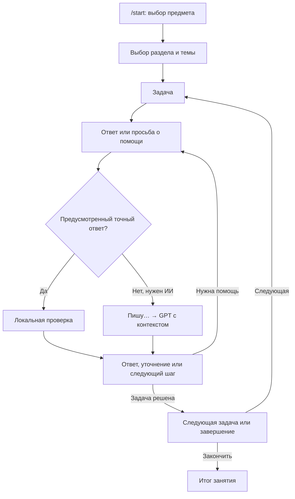

# Репетитор — учебный чат-бот в MAX

Конкурсный проект «ИТ-прыжок / IT-Jump 2026», номинация «Разработка чат-ботов», возрастная категория 11–14 лет.

**Автор:** Савенков Максим. Личный вклад: разработка сценариев, подбор задач, тестирование логики и ответов GPT, выявление ошибок и повторная проверка после исправлений. Код разрабатывался и исправлялся с помощью ИИ-помощника.

[Открыть бота «Дедус» в MAX](https://max.ru/se14794764_bot) · [Сценарий проверки](docs/DEMO.md) · [Архитектура](docs/ARCHITECTURE.md) · [Скриншоты](docs/screenshots/README.md)


## Проблема и решение

Готовое решение задачи не всегда помогает ученику самостоятельно решить следующий пример. «Репетитор» помогает разбирать физику и алгебру по шагам: задаёт наводящие вопросы, предлагает подсказки и объясняет проще. Цель — понимание способа решения. Это учебный помощник, а не замена учителю; ответы модели могут содержать ошибки.

Целевая аудитория — ученики 7–9 классов. Текущий банк наиболее подробно охватывает алгебру 8 класса. В 10 наборах находятся 185 карточек: 175 по алгебре и 10 по физике. Это подготовленная подборка, а не все упражнения учебников. [Источники материалов](docs/SOURCES.md).

## Что работает

- Физика: теплоёмкость, количество теплоты, тепловой баланс. Алгебра: рациональные и иррациональные числа, дроби, корни, уравнения, неравенства, функции, степени.
- Выбор предмета, раздела и темы; ответ текстом, подсказка, объяснение, следующая задача и завершение.
- Локальная проверка предусмотренных точных ответов; свободные рассуждения и объяснения с GPT через OpenAI Responses API.
- Индивидуальные занятия и результаты в SQLite; продолжение текущего занятия после перезапуска.
- Учёт самостоятельного решения, подсказок и объяснений; незавершённая задача не считается ошибкой.
- Сообщение «Пишу…» перед обращением к GPT; удаление неактуальных кнопок из старых сообщений с сохранением текста.
- Очереди входящих событий и ответов, защита от повторной обработки события, явный повтор неудачного запроса и отдельный повтор доставки.
- Пять локальных интерактивных примеров. В действующем MAX-боте они пока не опубликованы, поэтому кнопка скрыта.

## Как устроен диалог



Правильная известная форма ответа может проверяться без GPT. Неизвестная форма не объявляется автоматически ошибочной. Вопрос или просьба объяснить не должны засчитываться как решённая задача. Программа использует подготовленные критерии и проверяет структурированный ответ модели; это не гарантирует безошибочность любого свободного рассуждения.


## Надёжность и безопасность

Токены находятся вне кода. Запросы к SQLite используют параметры; вычисление арифметики ограничено проверяемой грамматикой, произвольный Python не выполняется. События проверяются перед постановкой в очередь. Старые и чужие кнопки не запускают действие текущего ученика. Веб-сервер не выдаёт базу, ключи и методические ответы через HTTP.

Перед платным запросом сохраняется его состояние. После сбоя незавершённый запрос автоматически не повторяется; пользователю предлагается явный повтор. Подтверждение удаления клавиатуры сохраняется, ошибка редактирования повторяется отдельно без GPT. «Пишу…» — отдельное сообщение без push-уведомления, которое не передаётся в учебный контекст модели.

В GPT передаются условие, критерии и учебная переписка; имя и MAX ID специально не добавляются. Если ученик сам написал личные данные в сообщении, они могут попасть в этот запрос. Перед началом бот сообщает о сохранении ответов для преподавателя. [Подробнее о данных](docs/PRIVACY.md).

## Проверки и известные ограничения

```shell
python -m unittest discover -s max_tutor/tests -v
```

В комплект входят тесты проверки ответов, диалога, изоляции учеников, восстановления, лимитов, доставки, очистки клавиатур, HTTP-контрактов и статуса ожидания. Они выполняются без реальных API-ключей. [Результаты проверки поставки](docs/VALIDATION.md).

Ограничения текущей версии:

- Один обработчик последовательно выполняет запросы GPT; при нескольких учениках возникает очередь. Одновременная независимая обработка GPT-запросов ещё не реализована.
- Нет загрузки произвольной книги, распознавания фото и полноценного режима решения любой присланной задачи.
- Есть ограничения роли и входных данных, но отдельный сервис модерации нежелательного контента не подключён.
- SQLite хранит состояние диалога; Redis/FSMContext не используются. Это нужно учитывать при буквальной проверке соответствующего пункта регламента.
- При неопределённом результате сетевой отправки `/repeat` может привести к дубликату сообщения.
- Состояние `reviewed` означает внутреннюю проверку карточки в проекте, а не независимую экспертизу учителя. Автотесты не доказывают педагогическую эффективность.

