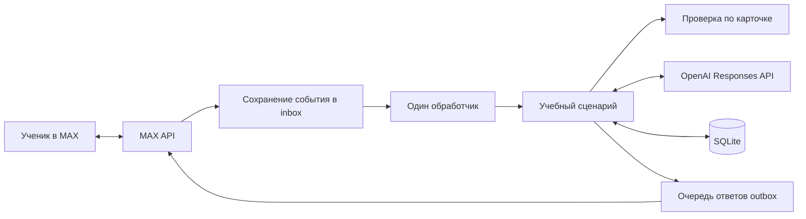

# Архитектура репетитора

## Основные компоненты

| Файл | Назначение |
|---|---|
| `__main__.py` | CLI, получение событий, один рабочий поток и запуск WSGI |
| `transport.py` | HTTPS MAX API, проверка сертификата, ограничение частоты отправки/редактирования |
| `bot.py` | Маршрутизация команд, индивидуальные кнопки, меню, доставка и очистка клавиатур |
| `lessons.py` | Переходы между задачами, помощь, лимиты, сохранение попытки перед GPT |
| `checks.py` | Проверка чисел, дробей, единиц и предусмотренных форм ответа |
| `tutor.py`, `policy.json` | Инструкции GPT, контекст, строгая схема ответа, обработка ошибок |
| `content.py` | Загрузка подготовленных карточек и справочник визуализаций |
| `storage.py` | SQLite, транзакции, очереди и восстановление |
| `web.py` | Webhook и выдача разрешённых файлов мини-приложения |

Все пути в таблице относятся к `max_tutor/`.

## Состояние и восстановление

Учебная сессия содержит тему, текущую задачу, сообщения, результаты, использованную помощь и журнал GPT-запросов. Состояния: `active`, `task_complete`, `ended`; следующая задача выбирается явным действием ученика. База содержит `users`, `inbox`, `outbox`, `budget`, `meta`, `keyboard_cleanup`.

Повторное событие MAX с тем же идентификатором не исполняется заново. Перед запросом GPT записывается `pending`; после успешного ответа — `completed`. Прерванная попытка при восстановлении помечается ошибкой и не запускается автоматически. Платная операция и повтор доставки разделены.

После замены меню старые кнопки сравниваются с текущими токенами пользователя. MAX получает PUT /messages с обновлёнными вложениями и без изменения текста. Успех фиксируется только при success=true. При ошибке редактирования повтор откладывается минимум на минуту.

## Границы реализации

Очередь позволяет принимать события во время ожидания GPT, но один обработчик выполняет учебные запросы последовательно. Это ещё не полноценная параллельная обработка нескольких учеников. Встроенный WSGI подходит для небольшого пилота за HTTPS-прокси. Docker, мониторинг круглосуточной доступности, автоматический перезапуск сервиса и отдельная система модерации в конкурсный комплект не входят.
